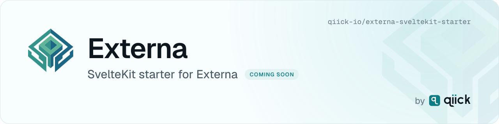

  <picture>
    <source media="(prefers-color-scheme: dark)" srcset=".github/assets/header-dark.svg">
    <source media="(prefers-color-scheme: light)" srcset=".github/assets/header-light.svg">
    
  </picture>

# externa-sveltekit-starter

Official **SvelteKit** headless starter for [Externa](https://github.com/qiick-io/externa-core), the open-source Laravel headless CMS.

> **Status: in development.** This repository does not contain the starter code yet. The first version is tracked in this repo's issues.

## What it will be

A minimal, TypeScript-first SvelteKit app that lists and shows items of one Externa collection through the Public CMS API (REST), with the same environment contract as the other official starters:

| Variable | Purpose |
| --- | --- |
| `EXTERNA_API_URL` | Base URL of your Externa install |
| `EXTERNA_API_KEY` | Bearer API key (server-side only, never shipped to the browser) |
| `EXTERNA_COLLECTION` | Collection slug to list and show |

## Documentation

- Externa docs: https://docs.externa.qiick.io/
- Headless starters: https://docs.externa.qiick.io/docs/headless-starter

Other official starters: [externa-next-starter](https://github.com/qiick-io/externa-next-starter), [externa-nuxt-starter](https://github.com/qiick-io/externa-nuxt-starter).

## License

[MIT](LICENSE)
